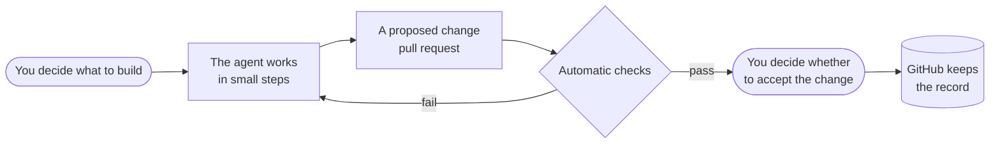

<!-- markdownlint-disable-next-line MD041 -->
<p align="center"></p>

# Start your project with checks already in place

plinth sets up the safeguards experienced engineers put in place when they
start a project. On GitHub, it protects the main version of your new Python
project and makes tests and other automatic checks run on every proposed
change. The checks scan the project's history for exposed passwords and keys.
Each proposal has its own page (a pull request), where the agent is prompted
to explain what changed and why.

You can start without figuring out which safeguards to turn on. Your AI agent
does the work. You decide what to build and which changes are ready to become
part of the project.

Claude Code is the only supported agent today. plinth aims to support more
agents.

Gated where a check can. Guided where it can't.
You decide. The checks answer. The record remembers.

## How a change gets in

On GitHub, a proposed change waits until the required checks report a pass.
plinth guides the agent to explain the choice and wait for your decision. That
wait is guidance, not a lock: an agent working with an administrator's login
can still accept a change itself. The path comes from how experienced
engineers run projects; whether the result is what you wanted stays yours to
judge ([why](docs/explanation/concepts.md#about-the-process)).



If you already have a project, `/plinth:floor-check` tells you what it could
verify and suggests a fix for each problem it finds. It leaves your files and
settings alone.

## Checking an existing project

Shortened from a real read-only check of
[nexusbt](https://github.com/coolbress/nexusbt), a project made with plinth,
on 2026-11-28. `/plinth:floor-check` was typed, and the agent ran the checker
that skill runs, from a copy of this repository. Cut where marked `[…]`,
among them the two items it listed (a login permission to narrow, and a newer
template release) and the count of checks passed; its closing question is
cut too. Nothing is reworded; bold is dropped.

```text
You:     /plinth:floor-check

Claude:  No check failed in what was read; 2 things to look at.
         Nothing was changed.

         […]

         The merge: guidance. This login is the repository's admin, and
         GitHub lets the admin merge (put a change into the main line),
         so an agent working under it can merge too; it is asked to wait
         for your word, not stopped.

         […]

         Next: type `/plinth:guide`; it names in plain words the one
         command to type next.
```

## Install plinth

No one but the author has used plinth yet.

plinth installs as a Claude Code plugin:

<!-- install-block:start -->
```bash
claude plugin marketplace add coolbress/plinth
claude plugin install plinth@plinth
```
<!-- install-block:end -->

In Claude Code, type `/plinth:new-project my-app`. You'll see the proposed
setup in one table before anything is created
([the tutorial](docs/tutorials/getting-started.md#create-the-repository) walks
through each choice). From there, [run a project](docs/how-to/run-a-project.md)
is the loop, stage by stage, and `/plinth:guide` names the next command at any
point.

## What you get

In a new project `/plinth:new-project` makes on GitHub:

| What is set up | What it means for you |
| --- | --- |
| Automatic checks on every proposed change: tests, type checks, a linter and a build | A change waits until the tests pass and the code builds |
| Rules for accepting changes into the main version | While the rules stand, every change arrives as a pull request, and the main version cannot be overwritten or deleted |
| A scan for exposed passwords and keys | The scan looks through the project's saved history for exposed passwords and keys. When it finds one, the check fails and tells you to revoke it. The secret may already be on GitHub |
| A check of new packages | plinth checks newly added or upgraded packages for serious known security problems |
| Code scanning | GitHub's code scanner holds a change with a serious security finding. On private GitHub projects, it requires GitHub Code Security |
| A size limit on each change | A change too large to review is sent back to be split |
| A form for each pull request's title | The title's form is checked, and the agent is prompted to say in the description what changed, why and how it was checked |
| A check of the setup itself | A check flags some changes that weaken the setup. If a change removes that check altogether, a separate inspection can spot the missing check after the change is accepted |
| Instructions and skills for the agent | The agent is guided to work in small steps and explain them in plain words; `/plinth:guide` names the next step |

On GitLab.com Free, the full set of checks must pass before a change can be
accepted, but GitLab does not require each individual check by name.

They come from three parts: a plugin for the agent (six skills, listed
[below](#skills-and-dependencies)), a project template (a Python project
managed with uv), and reusable CI that every project runs from one pinned
commit of this repository. Each check's name, what it asserts and its fix
are in [Required checks](docs/reference/required-checks.md).

## Honest limits

**The limits.** A green check means the properties it asserts hold, not that
the code is right, and a pull request can rewrite its own CI file so that
its checks do nothing ([what green means](docs/explanation/concepts.md#about-what-green-means)).
Anyone whose token has administration on the repository can change the
rules, an agent included when it works with such a token
([who can change the wall](docs/explanation/concepts.md#about-who-can-change-the-wall)).
The host blocks the merge; plinth set it up that way; neither blocks an
agent's actions. A production database, a credential, a spend ceiling and a
deployed app are outside every check
([what plinth does not do](docs/explanation/concepts.md#about-what-plinth-does-not-do));
[four things to set by hand](docs/how-to/set-four-things-by-hand.md)
cover them as guidance, not checks.
No one but the author has used plinth yet. It covers GitHub.com and, with a
lower wall, GitLab.com ([about GitLab](docs/explanation/concepts.md#about-gitlab)),
Python projects managed with uv, and Claude Code as the harness. An existing
repository is only read, except that one made from plinth's template is
offered template updates as a draft pull request. A private repository needs a paid
GitHub plan, and some protections need more ([about private repositories](docs/explanation/concepts.md#about-private-repositories));
GitLab.com Free protects a private project.

## Supported, and outside

> **Supported:** GitHub.com public repositories · personal or org owner with
> admin · Python (uv) · new repositories via `/plinth:new-project`; existing
> ones get a read-only `floor-check` · GitLab.com projects too, Free and up,
> with `/plinth:new-project <name> --host gitlab` and `glab` 1.122.0 or newer:
> a lower wall, no required checks by name
> ([about GitLab](docs/explanation/concepts.md#about-gitlab)); the GitLab pipeline
> is supported, skills are GitHub-first ([scope](docs/reference/gitlab-ci.md#scope)) · **Claude Code 2.1.274 or newer** as the
> harness (CI installs plinth on that version and on the stable channel; the
> user tasks ran on 2.1.282 and 2.1.283; skills follow the Agent Skills
> format and may load elsewhere, but only Claude Code is tested) · macOS / Linux (Windows via WSL) · tools: `claude`,
> `gh`, `git` (2.37 or newer: on an older one, the macOS system git included, the
> install fails with `index.lock: File exists`; `brew install git`), `uv`,
> `python3`.
>
> **Outside:** when a wall cannot be raised (no admin, no `gh` auth, a private
> repository on GitHub Free, personal or organization, where the token reads the
> plan) the tool stops before creating anything and says why; a token that cannot
> read the plan lets the ruleset call decide, and a refused one ends the run;
> for a private repository, a classic token without `read:user` (or `user`)
> on a personal account, or without `delete_repo`, stops before creating
> anything instead. A private repository on GitHub Pro, Team or Enterprise
> gets the same required checks, with CodeQL, dependency review and push
> protection only where GitHub Code Security and Secret Protection are
> enabled; the door names each part it left out and what stands in its place
> ([about private repositories](docs/explanation/concepts.md#about-private-repositories)).
> Other mismatches warn and continue. GitLab Self-Managed and GitLab Dedicated
> are not supported.

## Install, in detail

The default set runs no hook. Its skills cost context: Claude Code lists
them for the model and caps the whole skill listing, its own built-in skills
included, at 1% of the model's context window. At 1M that leaves room for all
of them; at 200k some descriptions are cut to about the skill's name, so they
still run when called by name, but Claude is less likely to pick them on its
own. The `skillListingBudgetFraction` setting raises the cap, and
plinth-template sets it. What each plugin costs and how the cap was measured
is in the arsenal's [Installed by default](skills/arsenal/installed.md)
table and the paragraph under it.

Third-party marketplaces do not auto-update by default. To move to a new version, run
`claude plugin marketplace update plinth`, then
`claude plugin update plinth@plinth`, then `/reload-plugins`: without the
marketplace update, the plugin update can stay on the old version. Moving from v2.45.0 or
earlier also takes, once and in this order, `claude plugin install plinth@plinth`
and then `claude plugin uninstall taste-skill@plinth`, before `/reload-plugins`:
Anthropic's `frontend-design` replaced `taste-skill` as plinth's page-design
skill (#1082). `update` does not remove taste-skill; before Claude Code
2.1.319 it does not install frontend-design either. From the release after
v2.46.0, Claude Code uninstalls taste-skill itself at the next session start
(#1229). If the uninstall then says `not found in installed plugins`, it is
already gone.
Moving from v1.11.0 or earlier also takes, once and in this order,
`claude plugin install plinth@plinth` and then `claude plugin prune`, before
`/reload-plugins`: `mattpocock-skills` moved to plinth's marketplace under the
same name, and `update` does not install the moved copy. Without the two
commands nothing is lost: the official copy keeps all of its skills, and
plinth reports the missing dependency with the command to run. `prune` removes
the official copy only where it arrived as plinth's dependency; one you
installed yourself stays beside plinth's (#477). Moving from v2.1.0 or
earlier, `claude plugin prune` after the update also removes
`/ponytail-audit`, which plinth now lists instead of installing; without it
the skill keeps working (#598). Moving from v2.18.0 or earlier also takes
`claude plugin update mattpocock-skills@plinth` once, and
`claude plugin update mattpocock-skills-extra@plinth` if you installed it,
before `/reload-plugins`: `update plinth` reads the dependency's new skill
list but keeps its files at the old commit, so until then
`mattpocock-skills` reports an error ("Path not found" for `retro`), `/retro`
is missing and the other skills still name `CONTEXT.md` (#714). No `prune` is needed.
`/plinth:floor-check` names a dependency left at an older commit than plinth's
marketplace pins, with the command that moves it (#743).

Auto-update is optional. To turn it on, start a session outside any project,
run `/plugin`, and choose Marketplaces, plinth, Enable auto-update. Do not press
it inside a project: there the same choice rewrites that project's committed
`.claude/settings.json`. The same menu turns it off. It also brings raised
dependency pins, with no `claude plugin update <name>@plinth` and without
asking. A new version can arrive right after the release pull request merges,
before the tag and the GitHub Release (#855). The pass runs in a session after
its first message, within about ten minutes: not when a session opens, and not
in `claude -p` ([When auto-update runs](https://code.claude.com/docs/en/plugins/loading#when-auto-update-runs)).
The session then shows `Plugin updated: plinth · Run /reload-plugins to apply`,
and keeps the old skills until `/reload-plugins` or a new session.

What was measured: [coolbress/plinth-template#208](https://github.com/coolbress/plinth-template/issues/208).

Tutorial: [Getting started](docs/tutorials/getting-started.md).

## Skills and dependencies

Six skills, prefixed `/plinth:`:

| Skill | Does | Who can call it |
| --- | --- | --- |
| `new-project <owner>/<name>` | Creates a repository with the required checks enforced; if a wall step fails it deletes the repository when the token allows and prints the URL when it cannot | You only: type `/` and pick it. The agent cannot see or run it; an agent saying it is not installed usually means the line was typed as text (`/plinth:arsenal` shows what is installed) |
| `floor-check [owner/name]` | Reads an existing repository against the same floor the CI job checks, the live ruleset, whether it is behind the template plinth is tested with today, and what this machine's Claude Code settings say about the sandbox; lists each miss with one fix; changes nothing | You or the agent |
| `records-check [owner/name]` | Counts what is out of place in the issue and pull-request records, judged by the repository's own written conventions: references to nothing, home paths, bodies near GitHub's size limit, completed issues with no ending, merged pull requests with no AI trailer; lists unticked acceptance criteria for a person to read; changes nothing | You or the agent |
| `template-update` | Applies the template update `floor-check` reports: runs its `copier update` line in a worktree beside the repository, branched from the verified default branch, and opens a draft pull request; on a conflict it recommends a resolution for each file and applies it only on your word, before anything is pushed | You only, and it asks before it writes |
| `arsenal` | Catalog of the tools below: what, when, cost | You or the agent |
| `guide` | Explains in plain words, in your language, the one command to type next, then what is open and what happened so far, copied from the record; before the first merge, how to use the tools of that step and the next from the arsenal's table; the whole way on one screen with `/plinth:guide map`, one step in depth with `/plinth:guide map <step>`, what started off with `/plinth:guide features`; changes nothing | You only: type `/` and pick it |

Every skill only you can start, these and the dependencies' together, is on
[one list in the arsenal](skills/arsenal/SKILL.md#skills-only-the-person-can-start).

Installed with plinth as dependencies, each pinned to a commit
([About pins](docs/explanation/concepts.md#about-pins)):
[mattpocock-skills](https://github.com/mattpocock/skills) (skills
from `/implement` and `/grilling` to `code-review`, `/to-spec`, `/handoff` and
`/retro`) and
[frontend-design](https://github.com/anthropics/claude-plugins-official/tree/main/plugins/frontend-design)
(Anthropic's, one skill: distinctive frontend design for pages people look at,
away from generic templates).
Listed but not installed:
`mattpocock-skills-extra`, more Matt Pocock skills, such as
`/ask-matt`, `/grill-with-docs` and `wizard` (#520, #704, #714);
`ponytail-skills`, one skill, `/ponytail-audit`: what to delete or replace
with the standard library, repository-wide (#598);
[last30days](https://github.com/mvanhorn/last30days-skill) (what people said
about a topic in the last 30 days; about 90k tokens per call, and a
`SessionStart` hook), `ponytail`, the full plugin with hooks, and
[Impeccable](https://github.com/pbakaus/impeccable), whose installer writes
hooks, agents and skills into the repository. The first four install from
plinth's marketplace: `claude plugin install mattpocock-skills-extra@plinth`,
`claude plugin install ponytail-skills@plinth`,
`claude plugin install last30days@plinth`,
`claude plugin install ponytail@plinth`. Run `/plinth:arsenal` for the
catalog; licenses are in [NOTICE](NOTICE).

Nothing in the plugin enforces anything. Enforcement is the ruleset on GitHub,
which `/plinth:new-project` raises and which owners cannot bypass; anyone
holding administration can still edit it
([About who can change the wall](docs/explanation/concepts.md#about-who-can-change-the-wall)).
When `gh` holds a fine-grained token, the generator stops and names two
fixes. The browser login is shorter, but its token is scoped `repo` across the
account rather than to selected repositories; the admin-token path keeps the
fine-grained token's narrow reach. The first is
`gh auth login -s repo,workflow`, which runs inside Claude Code
(a one-time code and a URL, finished in a browser), after which the generator
runs wherever it is started. Unset `GH_TOKEN` and `GITHUB_TOKEN` first if
either is set: `gh` uses them before any login it stores. Remove them from the
shell startup file they come from, and the login and the generator stay inside
Claude Code. The second is to rerun it through `scripts/with-admin-token.sh` in
a separate terminal, which prompts for an admin token there and keeps it off
every command line; the stop prints a link to a fine-grained token form with
the permissions filled in.

## Status

The install works end to end and CI proves it on a clean runner. `new-project`
creates a repository with the wall up. When a step that setup cannot go on
without fails after the create, it deletes the repository if its token can,
and otherwise prints the repository to delete; a step it can go on without,
such as a label, is named and left. If the create's own answer is lost, it
does neither, so check whether the repository exists (its failure paths run in CI against a mocked
`gh`). It renders
[plinth-template v1.52.0](https://github.com/coolbress/plinth-template/releases/tag/v1.52.0),
whose CI reports every check the wall requires. Since the release gate (#62),
each release is tagged only after `e2e`, run on its files, has
created a repository on real GitHub, merged its first pull request and deleted
it. When CodeQL has not analysed the first push after a while, the door
pushes one empty commit to start it (#117). The owner ran three tasks on a generated
repository with 0.5.28: a first feature, a recovery from a failure, and a
resume in a new session. The install, the login and a merge were run again
with 0.5.29. Both runs are in #65. No one but the author has used plinth yet
(#163). What each required check asserts, what a red means and its fix,
CodeQL on a head Dependabot pushed included (#179), is in
[Required checks](docs/reference/required-checks.md). `floor-check` runs the checker `ci / floor-check` runs, read-only;
exit 0 means no FAIL in what it could read, and its summary counts what it
could not. A third-party review check (`third-party / review`, Codex) is
available as an optional check; see
[docs/how-to/configure-the-third-party-reviewer.md](docs/how-to/configure-the-third-party-reviewer.md).
The [CHANGELOG](CHANGELOG.md) lists what each version adds.

## Further reading

- [Concepts](docs/explanation/concepts.md): why plinth is shaped the way it is.
- How-to, for users: [run a project](docs/how-to/run-a-project.md), what to
  type at each stage and what to check before you merge;
  [turn a correction into a rule](docs/how-to/turn-a-correction-into-a-rule.md),
  when you keep telling the agent the same thing;
  [choose where a web app runs](docs/how-to/choose-where-a-web-app-runs.md),
  Render or somewhere else, and what each place leaves to you;
  [make your own check required](docs/how-to/make-your-own-check-required.md),
  when pull requests should wait for a job you added.
- [Off by default](docs/reference/off-by-default.md): what a new project
  starts with turned off, when each is worth turning on, and how.
- How-to, for maintainers: [cut a release](docs/how-to/cut-a-release.md),
  [upgrade the template pin](docs/how-to/upgrade-the-template-pin.md),
  [run the eval suite](docs/how-to/run-the-eval-suite.md).
- [Decisions in force](docs/reference/decisions-in-force.md): the decisions
  that hold today, each with the record that holds it, and the pairs of
  records that still disagree.
- [Where shipped skills' rules came from](docs/reference/skill-sources.md):
  the record behind each rule a skill states without its issue number.
- [GLOSSARY.md](GLOSSARY.md): the vocabulary (wall, door, box, floor, arsenal, profile).
- [Terms a first project meets](docs/reference/terms.md): repository, pull
  request, check, merge and the rest, each in one plain line, and the rule that
  an explanation in another language keeps the English term in brackets.

Rebuilt in September 2026 from an earlier internal repository; its issues and
decisions moved here (the map is #15, the spec #31).
